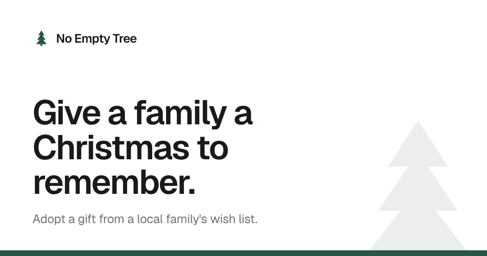

# No Empty Tree

**[noemptytree.com](https://noemptytree.com)** · A Christmas gift-adoption web app for a local community.



Families in need are nominated with a wish list for each household member. Donors sign
in, browse the families, and adopt individual gifts or a whole family's list, so no family
wakes up to an empty tree. The app is used each November and December by
non-technical donors, mostly on their phones.

## Features

- **Adopt families**: a list of this season's families with progress bars. Rows expand
  inline to show each member's wish list. Adopt one gift with an Undo toast, or adopt
  everything that's left after a confirm sheet (a bottom sheet on phones).
- **My adoptions**: the gifts you've adopted this season, grouped by family.
- **Shopping list**: a printable checklist of your gifts. Ticks sync to your account, are
  stored locally so they appear instantly, and queue while offline until the connection
  returns.
- **Past adoptions**: what you adopted in earlier seasons, filterable by year.
- **Nominate a family**: a three-step wizard (family → members and wish lists → review).
  It autosaves a draft, can be resumed, and is opened or closed by a database flag
  without a deploy.
- **Accounts**: email/password and Google sign-in, email confirmation, and password
  reset.
- **Seasons**: each family belongs to a Christmas year. Changing the active season starts
  a fresh year and keeps past data.

## Tech stack

- **Frontend:** Angular 22 (standalone components, signals, zoneless change detection,
  `@if`/`@for` control flow), Tailwind CSS, Angular CDK, and the View Transitions API for
  route cross-fades.
- **Backend:** Supabase (Postgres, Auth, and row-level security). There's no custom
  server: the browser talks to Supabase directly.
- **Hosting:** Vercel, as a static build.
- **Ops:** a scheduled GitHub Actions workflow
  (`.github/workflows/keep-supabase-alive.yml`) queries the database twice a week, so the
  free-tier project isn't paused between seasons.

## Security model

Because the browser talks to the database directly, authorization lives in Postgres
row-level security policies (see `supabase/migrations/`), not in the UI:

- Every page except the landing screen requires an account.
- Donors can only adopt an open gift for themselves, or release a gift they adopted.
  A trigger stops them from editing anything else about a gift.
- Only a family's nominator can change that family, its members, or its wish list.
- Families' addresses, phone numbers and emails can be submitted but can't be read back
  through the API. Organizers see them in the Supabase dashboard.
- Shopping-list ticks are private to each donor.
- Nomination settings can only be changed from the dashboard.

The Supabase URL and anon key in `src/environments/` are the public client credentials
that ship in every Supabase web app's bundle. They grant only what the policies above
allow.

## Project structure

```
src/app/
  components/       one folder per page or feature (adopt-family, my-adoptions,
                    shopping-list, past-adoptions, nominate-family, auth, header, ...)
  shared/           toast, confirm sheet, segmented control, animations, shared types
  supabase.service.ts   all data access
  auth.service.ts       session state as signals
  adoption.service.ts   adopt/unadopt with optimistic updates and Undo
supabase/migrations/    schema and row-level security changes
docs/APPLICATION_OVERVIEW.md   detailed walkthrough of workflows, data model and UI
```

## Running locally

Requires Node.js 22.22.3+ or 24.15+.

```bash
npm install
npm start          # http://localhost:4200
npm test           # unit tests (Karma + Jasmine)
npm run build      # production build in dist/
```

By default the app connects to the production Supabase project configured in
`src/environments/environment.ts`. To use your own, create a Supabase project, apply
the migrations in `supabase/migrations/`, and replace the URL and anon key in that file.
